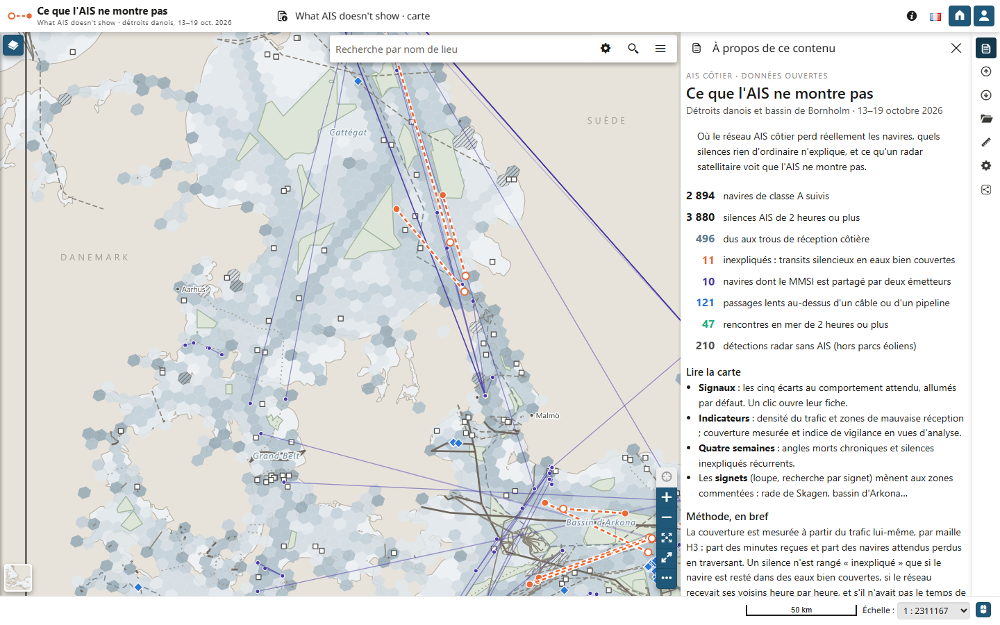
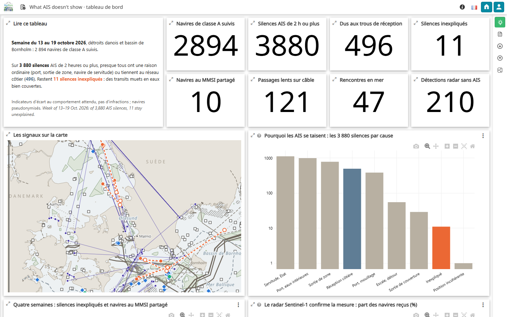
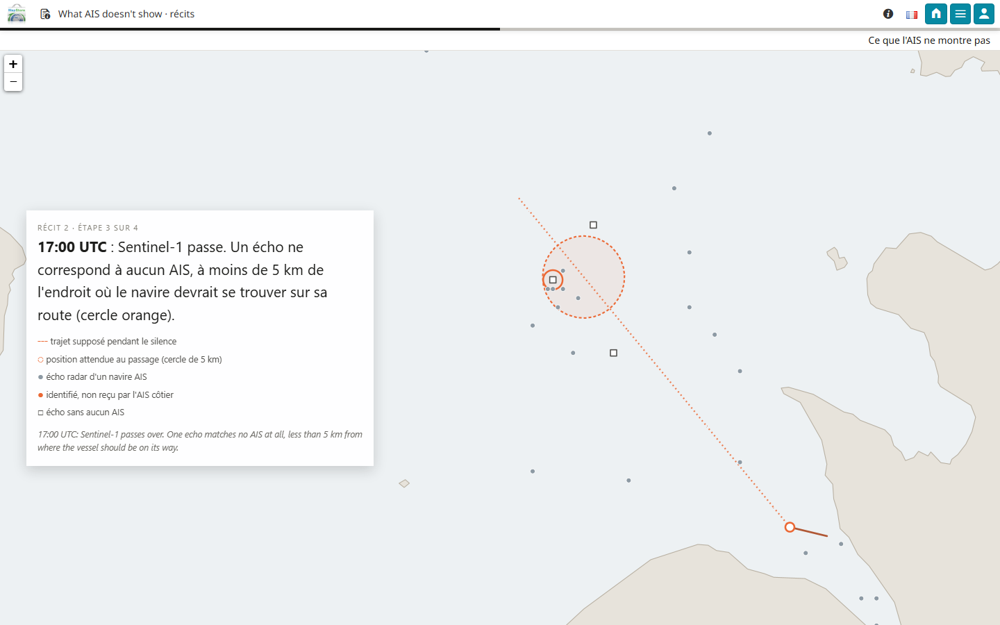

# MapStore + GeoServer + PostGIS : de l'installation à la mise en carte

Une pile **MapStore 2026.03** prête à l'emploi (Docker, Windows) branchée sur **PostgreSQL/PostGIS** avec
son propre **GeoServer**, et la chaîne complète qui publie le projet
[What AIS doesn't show](https://github.com/jauresmas/what-ais-doesnt-show) sous quatre formes : une carte,
une application cartographique dédiée, un tableau de bord et une GeoStory. Tout est scripté : une
installation neuve se refait avec une dizaine de commandes, sans clic dans les interfaces d'administration.

*English: a ready-to-run MapStore 2026.03 stack (Docker) on PostgreSQL/PostGIS with a dedicated GeoServer,
and the scripts that publish the "What AIS doesn't show" project as a map, a dedicated map application, a
dashboard and a GeoStory. Documentation is in French.*



| Tableau de bord | GeoStory |
|---|---|
|  |  |

## Ce que contient le dépôt

| Partie | Rôle |
|---|---|
| `docker-compose.yml`, `nginx/` | MapStore, GeoServer 2.28 (+ WPS) et nginx sur une seule adresse, `http://localhost:8097` |
| `datadir/` | configuration externalisée de MapStore : base PostgreSQL au lieu de H2, catalogue GeoServer, avis de confidentialité |
| `sql/` | rôles et bases PostgreSQL (`mapstore`, `what_ais_carto`), sans aucun mot de passe écrit |
| `configurer.py` | génère `.env` (mots de passe aléatoires), la connexion de MapStore et les polices ; crée les bases |
| `projets/what_ais/` | chaîne de publication du projet : PostGIS → GeoServer → MapStore |
| `pages/` | mentions, confidentialité et conditions d'utilisation (FR/EN), liées depuis MapStore |
| `outils/captures.mjs` | captures d'écran de la documentation |
| `docs/` | guides détaillés |

## Architecture

```
dépôt What AIS doesn't show ─(ogr2ogr)─▶ PostgreSQL 15 / PostGIS 3.5 (machine hôte, localhost:5432)
  (GeoPackages pseudonymisés)              │  base what_ais_carto, schéma carto : couches du projet
                                           │  base mapstore, schéma geostore    : cartes, utilisateurs
                                           ▼  (host.docker.internal:5432)
                         ┌─────────── Docker ───────────────────────────────┐
                         │  GeoServer 2.28 (WMS, WFS, WPS)  ◀──┐            │
                         │                                     │  nginx     │
                         │  MapStore 2026.03 ◀─────────────────┤  :8097     │
                         │                                     │            │
                         └─────────────────────────────────────┼────────────┘
                                   navigateur ─────────────────┘
                     /mapstore/  /geoserver/  /pages/  : même origine, pas de CORS
```

Les données géographiques restent dans PostGIS et passent par GeoServer ; la base `mapstore` ne garde que
les ressources MapStore (cartes, contextes, tableaux de bord, GeoStory, utilisateurs).

## Démarrage rapide

Prérequis : Docker Desktop, PostgreSQL 15+ avec PostGIS, QGIS (pour `ogr2ogr`), Python 3.10+, et le dépôt
What AIS doesn't show cloné avec ses données produites. Le détail, les variantes et les vérifications
sont dans [docs/installation.md](docs/installation.md). Toutes les commandes se lancent dans PowerShell,
à la racine du dépôt.

1. Configurer (crée `.env` avec des mots de passe aléatoires, jamais affichés) :

   ```powershell
   python configurer.py
   ```

   Si le dépôt What AIS n'est pas à côté de celui-ci, renseigner `WHAT_AIS_DEPOT` dans `.env`.

2. Créer les bases (psql demande le mot de passe de `postgres`) :

   ```powershell
   python configurer.py bases
   ```

3. Démarrer la pile (le premier lancement télécharge les images et l'extension WPS) :

   ```powershell
   docker compose up -d
   ```

4. Publier le projet ([docs/publication.md](docs/publication.md)) :

   ```powershell
   python projets\what_ais\01_charger_postgis.py
   ```

   ```powershell
   python projets\what_ais\02_publier_geoserver.py
   ```

   ```powershell
   python projets\what_ais\03_publier_mapstore.py
   ```

   La dernière commande affiche les adresses de la carte, de l'application, du tableau de bord et de la
   GeoStory.

## Adresses

| Quoi | Adresse |
|---|---|
| Accueil MapStore | http://localhost:8097/mapstore/ |
| Application, carte, tableau de bord, GeoStory | affichées par `python projets\what_ais\03_publier_mapstore.py adresses` |
| Administration GeoServer | http://localhost:8097/geoserver/web/ |
| Mentions et confidentialité | http://localhost:8097/pages/mentions.html |

Comptes : `admin` pour MapStore et pour GeoServer, mots de passe dans `.env`.

## Documentation

| Guide | Contenu |
|---|---|
| [docs/installation.md](docs/installation.md) | prérequis, installation pas à pas, vérifications |
| [docs/publication.md](docs/publication.md) | la chaîne PostGIS → GeoServer → MapStore, et comment sont construits la carte, l'application, le tableau de bord et la GeoStory |
| [docs/exploitation.md](docs/exploitation.md) | arrêt, sauvegarde, mise à jour, dépannage |
| [docs/notes-techniques.md](docs/notes-techniques.md) | ce qu'il faut savoir de MapStore 2026.03 et de son API GeoStore pour tout scripter |
| [projets/what_ais/README.md](projets/what_ais/README.md) | fichiers de la chaîne du projet |

## Sécurité

- Aucun mot de passe n'est versionné : `.env` et `datadir/geostore-datasource-ovr.properties` sont
  générés en local par `configurer.py` et ignorés par git. `.env.example` en donne le modèle.
- La pile n'écoute que sur `127.0.0.1:8097`. Pour l'ouvrir au réseau, passer par HTTPS (reverse proxy)
  et changer les mots de passe `admin`.
- Seules les couches d'affichage pseudonymisées du dépôt What AIS sont chargées ; aucune donnée à MMSI
  réel n'entre dans la base publiée.

## Données et licences

Les couches publiées viennent de [What AIS doesn't show](https://github.com/jauresmas/what-ais-doesnt-show),
qui détaille ses sources dans `docs/sources.md` :

- AIS : Autorité maritime danoise (DMA), réutilisation libre ; navires pseudonymisés par le projet.
- ZEE et mers territoriales : Flanders Marine Institute, Marine Regions (CC BY 4.0).
- Infrastructures : EMODnet Human Activities et BSH (CC BY 4.0), TeleGeography (CC BY-NC-SA 3.0),
  © contributeurs OpenStreetMap (ODbL).
- Détections radar Sentinel-1 : Powered by Global Fishing Watch (CC BY-NC 4.0, usage non commercial).
- Pays et terres : Eurostat GISCO, © EuroGeographics.
- Fonds de carte tiers : © contributeurs OpenStreetMap, © CARTO, Esri.
- Logiciels : MapStore (GeoSolutions, BSD), GeoServer (GPL 2.0), PostgreSQL, PostGIS, nginx.
- Polices : Segoe UI appartient à Microsoft ; elle n'est pas versionnée et `configurer.py` la copie depuis
  Windows.
